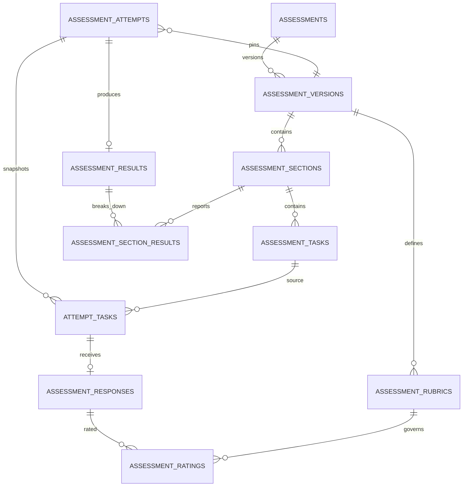

# Cumulative Assessment — Data Model and API Contracts

**Status:** Design proposal only; no runtime implementation.  
**Target branch reviewed:** `feat/a1-foundations-curriculum` at `27e3126fefbba1f08f2b16d9a0500158b453dd27` (including migrations `0001`–`0015`).  
**Current branch migration history:** `0001`–`0015`.  
**Related documents:** `ASSESSMENT-IMPLEMENTATION-DESIGN.md`, `A1-CUMULATIVE-ASSESSMENT.md`.

## 1. Decisions and non-decisions

### Decisions recommended for v1

1. Cumulative assessment is a separate aggregate from lesson attempts.
2. Published assessment versions and attempt task snapshots are immutable.
3. A task has exactly one response mode and one skill.
4. Objective tasks are server-scored from private keys. Writing and Speaking are human-rated.
5. Each attempt can have at most one accepted final response per task in v1.
6. Results are pending until all required scoring components are complete.
7. A final result is immutable; correction is an explicit audited revision, not an update-in-place.
8. Listening stimuli are references to pre-published content only. No learner audio recording or media upload in v1.

### Deliberately unresolved

- Whether the first Speaking mode is live examiner interaction or a non-recorded structured prompt administered outside the app. A self-recorded monologue must not be labelled interactive speaking.
- Exact duration, skill weights, pass threshold, score rounding and interpretation.
- Rater assignment model and whether double-rating/moderation is mandatory in the pilot.
- Listening asset delivery, licensing and accessibility mechanism.
- Retention duration, deletion/export behavior for written responses and rating audit data.

Do not create a migration until these decisions are approved and the exact schema has been inspected in Local D1.

## 2. Conceptual ERD



The ERD is conceptual. It intentionally does not specify a final physical schema or migration order.

## 3. Proposed relational contract

Use TEXT UUID/opaque IDs consistently with existing backend conventions. Timestamps should use the repository's established UTC ISO-8601 representation. Use CHECK constraints, unique constraints and composite foreign keys to enforce invariants in SQLite wherever possible.

### 3.1 Assessment catalogue

**assessments**
- `id` primary key
- `assessment_key` stable unique key, e.g. `a1-cumulative`
- `title`, `level`
- `created_at`

**assessment_versions**
- `id` primary key
- `assessment_id` FK RESTRICT
- `version` positive integer
- `status` constrained to draft/published/archived
- `duration_minutes` nullable positive integer (not fixed until pilot)
- `scoring_policy_json` or a normalized immutable policy-version FK; choose one, not both
- `created_by_user_id` FK SET NULL
- `created_at`, `published_at`
- UNIQUE(`assessment_id`, `version`)

Published versions must reject UPDATE and DELETE using triggers, consistent with existing lesson version protections. A new version is created as draft; publication is a guarded state transition after validation.

**assessment_sections**
- `id` primary key
- `assessment_version_id` FK RESTRICT
- `skill` CHECK in listening/reading/writing/speaking
- `title`, `instructions`, `position`
- `required` boolean integer
- UNIQUE(`assessment_version_id`, `skill`)
- UNIQUE(`assessment_version_id`, `position`)

**assessment_tasks**
- `id` primary key
- `section_id` FK RESTRICT
- `task_key` stable within section
- `task_type` constrained by supported v1 registry
- `response_mode` constrained to selected v1 modes
- `prompt`, `instructions`, `stimulus_json`
- `response_schema_json` validated by application code and JSON validity constraint
- `answer_key_json` private; objective task types only
- `max_score` positive integer/real
- `position`
- UNIQUE(`section_id`, `task_key`)
- UNIQUE(`section_id`, `position`)

Do not store answer keys inside candidate-readable JSON blobs. A candidate query must explicitly select safe columns and map to a DTO; never serialize raw rows.

### 3.2 Rubrics

**assessment_rubrics**
- `id` primary key
- `assessment_version_id` FK RESTRICT
- `skill` constrained to writing/speaking for initial v1
- `rubric_key`, `version`, `criteria_json`
- `created_at`
- UNIQUE(`assessment_version_id`, `skill`, `rubric_key`)

Each criterion has a stable key, label, bounded integer minimum/maximum, level descriptors and a positive maximum weight. Validate that weights sum to the policy-defined denominator. Snapshot the exact rubric ID and criterion definition into each productive task attempt. Do not let an edit to a later draft alter an in-progress attempt.

### 3.3 Attempts and snapshots

**assessment_attempts**
- `id` primary key
- `user_id` FK RESTRICT (or match the existing account-deletion strategy after inspection)
- `assessment_version_id` FK RESTRICT
- `status` CHECK in in_progress/submitted/completed/abandoned/expired
- `started_at`, `submitted_at`, `completed_at`
- `created_at`
- index (`user_id`, `created_at` DESC)
- index (`assessment_version_id`, `status`)

**attempt_tasks**
- `id` primary key
- `attempt_id` FK RESTRICT
- `source_task_id` FK RESTRICT
- `section_skill`, `section_position`, `task_position`
- `task_type`, `response_mode`
- `prompt_snapshot`, `instructions_snapshot`, `stimulus_snapshot_json`
- `response_schema_snapshot_json`
- `private_answer_key_snapshot_json` nullable
- `max_score_snapshot`
- `rubric_id_snapshot` nullable
- UNIQUE(`attempt_id`, `source_task_id`)
- UNIQUE(`attempt_id`, `section_position`, `task_position`)

The attempt snapshot is the authority after start. Keep the source FK for traceability, but candidate task rendering and scoring must read snapshot fields only. Protect snapshots against update/delete with triggers. Consider whether storing a private answer-key snapshot in this table is appropriate; if so, all learner-facing queries must exclude it explicitly.

### 3.4 Responses and idempotency

**assessment_responses**
- `id` primary key
- `attempt_task_id` FK RESTRICT UNIQUE (one final submission per task in v1)
- `payload_json` JSON-valid, size-limited by application code
- `payload_hash` fixed-length canonical digest
- `idempotency_key` bounded opaque value
- `status` CHECK submitted/invalidated only if invalidation is an audited state
- `submitted_at`
- UNIQUE(`attempt_task_id`, `idempotency_key`)

Canonicalize and validate the typed payload before hashing. The same key and same hash returns the original receipt; same key with a different hash returns 409. A different key after a final response returns 409 in v1. Never include raw payloads in logs.

Proposed typed payload examples:

```json
{
  "responseType": "choice",
  "selectedOptionId": "opt-b"
}
```

```json
{
  "responseType": "text",
  "text": "Hello Sam, I can meet at..."
}
```

For a non-recorded speaking pilot, a structured examiner outcome is not a learner response and should be submitted only through the authorized rater workflow. Do not accept arbitrary media URLs from the client.

### 3.5 Ratings and results

**assessment_ratings**
- `id` primary key
- `response_id` FK RESTRICT
- `rater_user_id` FK RESTRICT
- `rubric_id` FK RESTRICT
- `criterion_scores_json` JSON-valid
- `total_score`, `max_score`
- `decision_key` bounded
- `rated_at`
- UNIQUE(`response_id`, `rater_user_id`, `decision_key`)

If policy allows exactly one rating, add a unique response constraint. If independent double-rating is required, model rating slots/assignments explicitly; do not use accidental duplicate rows as moderation.

**assessment_results**
- `id` primary key
- `attempt_id` FK RESTRICT UNIQUE
- `status` CHECK pending/final
- `overall_score`, `max_score`
- `scoring_policy_snapshot_json`
- `finalized_at`
- `created_at`

**assessment_section_results**
- `id` primary key
- `result_id` FK RESTRICT
- `skill`
- `raw_score`, `max_score`, `normalized_score`, `weight`
- `scoring_evidence_json` limited to safe, auditable references
- UNIQUE(`result_id`, `skill`)

Result rows are server-owned. Store the exact scoring policy snapshot and unrounded component values needed to explain the final calculation. No CEFR level, pass/fail or certification label until a separately approved interpretation policy exists.

## 4. API request and response contracts

All paths are provisional under `/api/v1`. Existing API envelope and error conventions take precedence; inspect and reuse them rather than introducing a second envelope.

### GET /assessments

Candidate-safe response:
```json
{
  "data": [{
    "id": "assessment-id",
    "key": "a1-cumulative",
    "title": "A1 Cumulative Assessment",
    "level": "A1",
    "version": 1,
    "durationMinutes": null,
    "skills": ["listening", "reading", "writing", "speaking"]
  }]
}
```

Only published versions are eligible. Do not return draft metadata.

### POST /assessments/:assessmentId/attempts

Request: empty body in v1; the server chooses the current published version.

Response:
```json
{
  "data": {
    "attemptId": "opaque-id",
    "status": "in_progress",
    "assessmentVersion": 1,
    "startedAt": "UTC timestamp"
  }
}
```

The insert and all task snapshots must commit atomically. If no valid published form exists, return 404/409 per existing API conventions and create no partial attempt.

### GET /assessment-attempts/:attemptId

Returns only the authenticated owner's attempt. Candidate task DTO:
```json
{
  "id": "attempt-task-id",
  "skill": "reading",
  "taskType": "multiple_choice",
  "responseMode": "choice",
  "prompt": "Read the notice...",
  "instructions": "Choose one answer.",
  "stimulus": {"kind": "text", "content": "Library open..."},
  "responseSchema": {"type": "choice", "optionIds": ["opt-a", "opt-b"]},
  "position": 1,
  "responseStatus": "not_started"
}
```

Do not expose `answer_key_snapshot_json`, expected answers, hidden transcripts, rater notes or private rubric guidance.

### PUT /assessment-attempts/:attemptId/tasks/:taskId/response

Request:
```json
{
  "idempotencyKey": "client-generated-opaque-key",
  "response": {
    "responseType": "text",
    "text": "A short learner response."
  }
}
```

Response:
```json
{
  "data": {
    "accepted": true,
    "duplicate": false,
    "responseStatus": "submitted"
  }
}
```

The authenticated user must own the attempt; the task must belong to it; the attempt must be in progress; payload type/size must match the snapshotted response schema. Do not return correctness for objective tasks until the whole assessment/section's disclosure policy permits it.

### POST /assessment-attempts/:attemptId/submit

Request: empty body. The server atomically checks required tasks and changes the state once. Decide before implementation whether unanswered tasks are allowed and treated as zero; the policy must be explicit and snapshotted.

Response:
```json
{
  "data": {
    "status": "submitted",
    "resultStatus": "pending"
  }
}
```

Same repeated request returns the stored state. Concurrent response submission versus attempt submission must have a single deterministic winner based on conditional writes/transaction semantics.

### GET /assessment-attempts/:attemptId/result

Pending:
```json
{"data":{"status":"pending","sections":[],"overallScore":null}}
```

Final:
```json
{
  "data": {
    "status": "final",
    "sections": [
      {"skill": "reading", "score": 8, "maxScore": 10, "normalizedScore": 80, "weight": 0.25}
    ],
    "overallScore": 76,
    "interpretation": null,
    "finalizedAt": "UTC timestamp"
  }
}
```

The sample values are illustrative, not a recommended cut score. A result endpoint must never disclose another learner's result or private examiner notes.

## 5. State transitions and concurrency

| Aggregate | Allowed transition | Guard |
|---|---|---|
| Assessment version | draft → published | Complete validation; authorized publisher |
| Assessment version | published → archived | New attempts blocked; existing attempts remain readable |
| Attempt | in_progress → submitted | Owner; required-task policy satisfied |
| Attempt | in_progress → abandoned | Owner or explicit expiry process; conditional update |
| Attempt | submitted → completed | Every required scoring component exists; finalization wins once |
| Response | absent → submitted | Attempt in_progress; unique task response |
| Rating | absent → rated | Authorized assigned rater; valid rubric; idempotency |
| Result | pending → final | All required skill scores exist; unique attempt result |

Do not allow direct submitted → in_progress, completed → in_progress or final → pending transitions.

### Required Local D1 integration tests

- Start attempt racing against assessment publication/archive.
- Start retry cannot create duplicate attempts unless explicit retake policy permits it.
- Snapshot is complete or absent; no partially populated attempt after a failed batch.
- Candidate cannot read or mutate another user's attempt/task/response/result.
- Published source edits do not change an existing attempt's prompt, task order, answer key or rubric.
- Same idempotency key/same payload returns same receipt.
- Same key/different payload returns 409.
- Different key after accepted final response returns 409.
- Two concurrent final responses for one task yield exactly one accepted payload.
- Response write racing with attempt submit has deterministic outcome.
- Two concurrent finalizers create one result and one section-result set.
- Unauthorized/unassigned rater cannot rate; duplicate rater decision is idempotent.
- Invalid score bounds, missing criteria, malformed JSON and oversized text are rejected.
- Final result cannot be changed by subsequent draft publication or policy changes.

## 6. SQLite implementation cautions

- SQLite JSON validity checks are useful but do not replace typed application validation.
- Avoid relying on `changes()` across statements without understanding D1 batch execution semantics; test the exact transaction behavior.
- Use composite unique constraints to enforce scope, not only application-side lookups.
- Keep FK actions restrictive for published forms, attempts, responses, ratings and results; do not cascade-delete evidence needed for audit.
- Use explicit SELECT lists for learner DTOs; never use `SELECT *` on tables containing private keys.
- Use indexes for owner history, pending rating queues and attempt task retrieval only after query-plan evidence.
- New migrations are forward-only and must be tested from an empty DB and an upgrade DB at this exact branch head.

## 7. Migration planning gate

Do not assign a migration number or write SQL until:
1. The target branch head and current migration directory are re-fetched.
2. Existing `0001`–`0015` are applied to isolated Local D1 and the resulting schema is inspected.
3. Product decisions in section 1 are resolved.
4. A physical ERD is reconciled with the actual user deletion/retention model and RBAC tables.
5. Constraints and triggers are reviewed for SQLite/D1 compatibility.
6. A rollback/recovery note is written (forward repair only; no destructive down migration).
7. Tests cover empty install and upgrade from current branch schema.

## 8. Implementation order

1. Finalize response modes and non-recorded speaking pilot semantics.
2. Finalize assessment version publication and scoring-policy shape.
3. Build objective Listening/Reading vertical slice.
4. Add Writing submission and human rating.
5. Add Speaking only after the interaction mode and privacy model are approved.
6. Pilot and standard-set score interpretation before displaying a proficiency claim.

No production deployment, remote D1 migration, secret mutation, paid service, audio upload or R2 resource is authorized by this design.


## 9. Verified integration points in the current branch

The following facts were checked against the branch's actual migrations and API documentation, not inferred from the conceptual model:

- The branch contains migrations `0001`–`0015`; the main-branch data-model document still describes the earlier `0001`–`0010` sequence. New work must use the feature branch's full schema history.
- `users` is the internal principal. `sessions` cascade on user deletion. `lesson_attempts` also currently cascade on user deletion, while lesson references are restrictive. The proposed assessment retention behavior must explicitly choose whether candidate deletion cascades, anonymizes, or retains legally required scoring evidence; do not silently choose RESTRICT or copy the lesson behavior.
- Current `user_roles.role` CHECK permits only `admin`, `content_author`, `content_reviewer`, and `support`. There is no `assessment_rater` role or rater-assignment table. Do not reuse `content_reviewer` as a rater implicitly: content review and learner assessment rating are different privileges. A dedicated role and assignment scope require a reviewed forward-only migration and owner-controlled grants.
- `admin_audit_events` already provides append-only privileged-action history with actor anonymization on deletion. Rating decisions and any reassignment/re-rating should emit allowlisted audit events, while criterion scores and learner response content should not be copied into general audit metadata.
- `assessment_policy_versions` already exists but is currently linked to lesson attempts and stores the existing weighted-percentage lesson quiz policy. A cumulative assessment scoring policy needs a distinct typed contract and immutable version identity; do not overload `percentage-v1` or change its meaning.
- The existing API success envelope is `{data, meta:{requestId}}`; errors use the repository's error envelope. Proposed examples in this document are illustrative and must be adapted to these exact conventions before OpenAPI/route implementation.
- Current timestamps use UTC ISO-8601, often generated with `strftime('%Y-%m-%dT%H:%M:%fZ','now')`. New tables should match the established representation.
- The backend's existing role middleware and admin audit patterns should be reused, but only after checking exact middleware exports and route registration on the target head.

### Required design changes before a migration

1. Decide account deletion and retention semantics for attempts, written responses, ratings and final results.
2. Define a separate `assessment_rater` privilege (or an explicitly narrower equivalent) and assignment model; do not grant it through public APIs.
3. Define whether one rater or two independent raters are required per productive response, and how disagreements are resolved.
4. Separate cumulative scoring policy versioning from lesson `assessment_policy_versions`.
5. Reconcile response DTOs with the existing API envelope and error codes.
